<p align="center">
  
</p>

<p align="center">
  <a href="LICENSE"></a>
  
  
  
</p>

<p align="center">
  <b>Listen to Claude Code instead of reading it.</b><br>
  A summary or the full reply, read aloud by a natural voice that runs on your machine.<br>
  <a href="#install">Install</a> · <a href="#use">Use</a> · <a href="#settings">Settings</a> · <a href="#cost-and-privacy">Cost and privacy</a> · <a href="#how-it-works">How it works</a>
</p>

---

A small bar sits above the prompt. Choose how each reply is spoken, pause it, replay it, or jump to any section:

```
Voice [ Off ][ Summary ][ Full ] [ Pause ][ Stop ][ Replay ] speaking · section 2/5
Sections [ 1 Result ][ 2 What changed ][ 3 Why ][ 4 Next steps ][ 5 Part 5 ]
```

## Features

- **Summary**: a short spoken version of the reply, like a colleague's quick verbal update.
- **Full**: the whole reply, read section by section. The current section is highlighted.
- **Sections**: press any section to listen from there.
- **Offline voice**: speech is made on your machine with [Kokoro](https://github.com/thewh1teagle/kokoro-onnx). The voice itself needs no API key and costs nothing.
- **Nothing is generated twice**: audio is cached, so Replay, Resume and the section buttons start at once.
- **One bar per session**: each Claude Code window plays only its own reply. If another window is speaking, the bar says so.
- **Knows who is talking**: with several sessions open, summaries start with the project name ("In checkout-service. Tests pass.").
- **Tells you when you're needed**: "api-server needs your approval" when a session hits a permission prompt or asks a question, so you can look away.
- **Listen fast**: up to 2x speed, and Next skips to the following section.
- **Not just English**: pick a Spanish, French, Hindi, Italian, Portuguese, Japanese or Chinese voice, and summaries come out in the reply's language.

Built for hands-free and eyes-free work: cooking, walking around while a long task runs, reading fatigue, dyslexia, or just preferring to listen.

> **Early access:** the bar uses Claude Code's plugin hooks API, which is still marked early access and may change between releases.

## Install

In Claude Code, run:

```
/plugin install voice-reader --marketplace abhinay-hat/voice-reader
```

Answer `y` to add the marketplace, then pick a scope (user scope is the usual choice).

Or from a shell:

```
claude plugin install voice-reader --marketplace abhinay-hat/voice-reader
```

### Command Code

voice-reader also runs in [Command Code](https://commandcode.ai) as a mod, with the same voice, cache and settings:

```
cmd mods add -g abhinay-hat/voice-reader
```

Replies are spoken automatically, `/speak` takes the same arguments, and `/speak panel` opens a Voice pane with the mode, play, stop, replay, next and section buttons (Alt plus the letter shown on each, for example Alt+l for Full). Settings live in the command: `/speak voice bf_emma`, `/speak speed 1.5`, `/speak alerts off`. Headless `cmd -p` runs stay silent.

### First run

The first reply after installing sets the voice engine up in the background. The bar shows *installing voice engine*, then *downloading voice model*. This happens once:

- A private Python environment is created in `~/.claude/voice-reader/venv` (with [uv](https://docs.astral.sh/uv/) when you have it, else `python3 -m venv`).
- The Kokoro model is downloaded to `~/.claude/voice-reader/models`: 325 MB for the full model plus 28 MB of voices, or 92 MB with the `int8` model (see Settings).

To do it ahead of time, run `/speak setup`.

### Requirements

- macOS or Linux. Windows is not supported yet.
- Python 3.9 or newer as `python3`.
- An audio player: `afplay` (built into macOS), or on Linux one of `pw-play`, `paplay`, `aplay` or `ffplay`.

## Use

| Control | What it does |
|---|---|
| Off / Summary / Full | How each new reply is spoken. The choice is shared by all sessions. |
| Play / Pause / Resume (`p`) | Pause and resume, also while the next part is still being made. |
| Stop (`s`) | Stop this session's voice. |
| Replay (`r`) | Speak this session's latest reply again, in the current mode. |
| Next (`n`) | Skip to the next section (Full mode). |
| Sections | Listen from that section to the end. |

Typing a new prompt stops that session's voice. Other sessions keep playing. When a reply finishes in any session, it takes over the speakers.

The same controls work as a command: `/speak off|summary|full|play|stop|replay|next|setup|<section number>`. `/speak` with nothing after it cycles the mode.

## Settings

Open `/plugin`, choose voice-reader, then Configure:

| Setting | Default | Notes |
|---|---|---|
| Voice | `af_heart` | Any Kokoro voice. The first letter sets the language: `a` US English (`af_heart`, `am_michael`), `b` UK English (`bf_emma`, `bm_george`), `e` Spanish (`ef_dora`), `f` French (`ff_siwis`), `h` Hindi (`hf_alpha`), `i` Italian (`if_sara`), `p` Portuguese (`pf_dora`), `j` Japanese, `z` Chinese. |
| Speed | `1.0` | 0.9 to 2.0. |
| Model | `full` | `int8` downloads less (92 MB) and runs a little faster, at slightly lower quality. |
| Summary model | `haiku` | The model that writes the spoken summary. `none` reads the opening sentences instead. |
| Spoken alerts | `permission` | Say when a session needs approval or has a question. `permission+idle` also speaks when Claude has been waiting a while; `off` never. |

`VOICE_READER_HOME` moves the data folder away from `~/.claude/voice-reader`.

## Cost and privacy

- The voice runs on your machine. No audio or text is sent anywhere to make speech.
- **Summary mode makes one small model call per reply** (Haiku by default), using your Claude Code login, so it counts toward your usage. Replies under about 350 characters are read as written, with no call. Set Summary model to `none` to make no calls at all.
- Each session's latest reply is saved as plain text in `~/.claude/voice-reader/sessions/` so it can be replayed. Session folders are deleted after 7 days, and cached audio after 3 days. Delete the folder at any time to clear everything.

## How it works

```
hooks/register.tsx   the bar, /speak, and the Stop and prompt events
backend/vr.py        saves each reply, splits sections, runs Kokoro, plays audio
backend/sections.py  splits a reply at its headings (or paragraphs)
backend/clean.py     turns markdown, tables, links and paths into speakable text
```

When a reply finishes, the plugin saves it under the session's id and splits it into sections. Then it starts a background runner. The runner makes audio for each section in order (cached by text) and plays each part as soon as it is ready, while the next is still being made. The bar reads a small status file once a second, so idle polling starts no processes.

## Want to talk back?

voice-reader is about listening. For a two-way voice conversation with Claude Code, use [VoiceMode](https://github.com/mbailey/voicemode).

## Uninstall

```
/plugin uninstall voice-reader
rm -rf ~/.claude/voice-reader
```

## License

MIT. The Kokoro-82M model and voices are Apache 2.0, and [kokoro-onnx](https://github.com/thewh1teagle/kokoro-onnx) is MIT.
